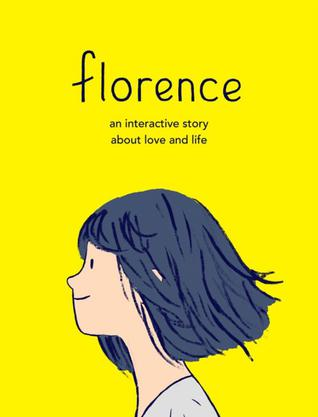
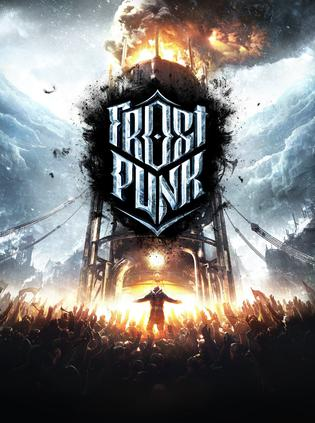
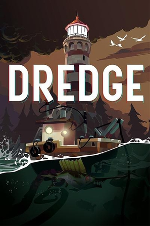
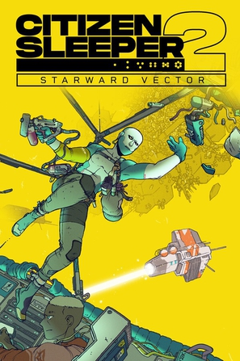
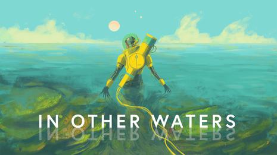
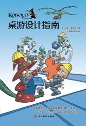
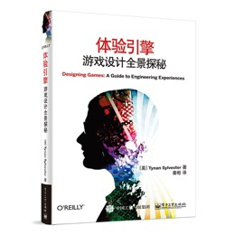

作为一个从业者，脑袋常常被屁股左右，被金钱和工作压力不知不觉地影响自己的观点。我想提醒自己，要自由地思考，在这个列表里抛开一切，只有一个标准，你只需要问你自己——你有没有感动，被拥抱的那种感动。

过去我玩过很多游戏, 有些是为了从现实中逃避出来, 大多数是和朋友们一块儿找个事儿做. 当我离开我的朋友们的时候, 那些我都不愿意再玩了。

一种方法是遗忘，我相信遗忘。我能想起来的是一个故事，一些人物，一种优雅的理论，游戏引发的感情。
另一种方法是感动，超越平常的那种感动，一种美感。
你应该把你的时间，你的注意力和你的兴趣相协调，简单说你应该做你感兴趣的。

身份，identity，类型是成见，他们是过去经验的总结，我们在这个基础上收缩，但也会限制自己。如果你真的被某个东西打动了, 你感受得到它的美, 那么真实的感受应该要超越被总结出的经验, 它应当被接纳, 成为新的规则。也就是说，感受汇聚成经验，然而有些时候又要超越经验，在某些时候要相信自己的感受，当然更要超越外界的权威和知识。

Frostpunk是8-10小时, 有一个吸引人的故事的，引发我的感情。A Short Hike是2-3小时, 拥有一个轻松的氛围, 简单的机制, 在中午玩儿完的甜品，如果它更长更复杂我反而不愿意去玩儿，由此可见游戏适合的时间不同。

我想再提醒自己一点。其实不仅是工作会影响我的判断，舆论也会，比如说游戏其实源自街机，所谓"正统"其实是格外强调游戏性(gameplay)的, 有时候我会太关注原创的，权威的游戏性-一个我没有才能, 也并不感兴趣的东西, 而忽略了其他可贵的事物。

每天都有许多的游戏被制造出来，然后销售。有一些游戏，你觉得它有些地方也不错，但是它没能打动你，那就不够。不够。那些还行的东西，也有些不太行，我们应该从中学习，还是避开他们呢？我不知道，我们需要读得更多，把更多的时间放在事物上，这样就不用用一些简单的方法和原则来节约时间。

------

1.弗洛伦斯 Florence 

x 3

看到[鸭鸭侦探 Duck Detective](./好看)让我理解了为什么Florence是一个非常好的游戏。
Florence和duck在抽象的游戏结构上是相仿的，收集-推进，也可以叫拼图结构（去完成一些事情，然后推进到下一个场景），但florence从来不是重复地，一次又一次地点击显而易见的目标，它的谜题，需要玩家做出的动作和游戏情景高度融合，和生活相呼应并激发产生对应的情感。
duck的幽默和轻松体现在对话的句子和美术风格上，但你一旦开始玩就会发现这个世界非常单调——它需要玩家实现的目标，它允许玩家在这个世界进行的动作非常重复。他的幽默过于浅显过于刻意，以至于人们感觉是在挑逗，也缺乏由头，这样一个故事就更难让人进行下去了。

如果让我去描述这个游戏的组织结构，我会说它是一个由谜题、由这种互动玩具组织起来的一段旅途，它融合在故事里，非常完美地讲述了一段故事。它最有趣的地方在于，这个故事贴近人们日常生活的故事，它本身就很好地调动人们的情感，而这个互动形式本身也能够激发人们的情感。

从产品的角度来看，那么它是一个非常有趣，有感情的互动产品。如果你完全从一个故事的角度去看它，你从一些文学或者各种各样的角度去看，那么我们很难说它在文学性上面有什么探索和突破。

2.冰汽时代 Frostpunk 

x 2

充满紧张，但是又触动人心
游戏设计学习的目标之一
我在想这种城市建设的游戏很多。他们大多数都有一个人民这样一种宏观的数值去产生需求，对城市进行评价。他们都是以建筑为主体，然后以发展为这个主要循环，有一定的这个生产关系，Frost Punk跟他们不一样的是，他们大多数都走向这种，他们要解决的问题是要到达下一个阶段，你要怎么去扩张你的链条，怎么优化你的效率，它是对一个经济和空间生产链条和空间问题进行求解，解决经济问题。但是Frost Punk并没有在这个方向深入，他走了一条全新的路。我觉得我还是没能真正理解，他所发展的那个方向。但那是一个激动人心的方向。

另外一点我注意到的是frostpunk，rimworld，活侠传，以及逃往南方中的liza的故事，驱动的都是玩家比较原始的感情，比如说死亡，爱情，饥饿，孩子，名利，过程出奇的简单直接，效果也非常好，具有普遍性和强烈的感觉，到了frostpunk2开始涉足议会和正义等话题，复杂性也提高了，这时候这个游戏的情感力量就下降了（也许人们总是提到的政治话题不是一个真正的方向？）。

3.短途旅行 A Short Hike 

探索, 温馨, 一个简单但有趣的机制和成长把一切串联起来, 有意思
不过这个游戏较短，也是我会去玩这样一个游戏的原因之一
游戏设计学习的目标之一

4.渔帆暗涌 DREDGE 

游戏设计学习的目标之一

探索, 冒险, 发现. 
其实这个游戏底层有一个跟打怪升级同样结构的机制。你想要改造自己的船只，需要更多的零件、更昂贵的钱，而这些需要去到更深的海、更独特的海域。这一设计能够引导玩家去探险体验新的内容。所以这是游戏的底层的一种经济结构，它为资源，成长，探索提供了经济支撑。
人们喜欢设计属于自己的东西，然后去和这个世界互动。当你在游戏中选择一个职业，搭配技能去战斗的时候如此。在这条船上按你自己喜欢的方式去组装和升级这条船，然后去面对世界也是如此。

这个游戏最初的和最重要的驱动力来自于神秘，探索，并和这个世界互动，你不知道深海里有什么，你不知道远方有什么。于是你储蓄，成长，扬帆起航。你发现一个小岛上有画家，你发现远方的一个岛屿里有巨大的鲨鱼，你发现在山谷里面有奇怪的鱼类。还有什么呢？你会问自己。

5.深空梦里人2 Citizen Sleeper 2: Starward Vector 

x 3
好玩
游戏设计学习的目标之一。

6.孤星寂海 In Other Waters 

好玩, 不是那种强烈牵引着你, 让你心跳加速欲罢不能的东西. 它安静, 和谐, 优雅, 引人深入, 让人回味. 我以为它会把流程做长, 我看着那个47%的进度, 已经有些厌烦的时候它正好结束了, 很好, 不多也不少。
探索, 冒险, 发现. 故事是其中的一部分，是一个引导而不是主轴。

7.桌游设计指南 

游戏书籍里我读过最有用的书，其他书里讲到的丰富的细节后来我都忘了，这本书我却常常想起来。

8.体验引擎 

9.活侠传 Legend of Mortal 

x 2
开发者访谈：https://game.udn.com/game/story/122090/8114531

故事中的情感和人的经验联结，具有巨大的力量，能够调动这种力量的媒介都具有惊人的力量，无论是frostpunk，还是活侠传。
比如说《司晨之书》The Book of Hours这样的游戏再叙事上都很有新意，可是它没能调动情感，故事。
为了让玩家感觉到这些东西，玩法应该简洁，符合逻辑，不侧重于策略和数值计算。

[[活侠传-评论]]
