这里放了一些游戏，我没有完整地玩完，或者说我并不觉得它特别好玩，又或者说它对我缺乏吸引力。尽管如此，但我仍然感觉到它有些地方很有意思，是可以参考和借鉴的。

我觉得在我学习游戏设计的过程中，我应该找一些比较经典的游戏，或者找一些我感兴趣的游戏的设计师喜欢的游戏。而不是每天对着那个游戏更新列表去找，这样子就像在沙里找金子一样非常低效，我几乎丧失了对能够设计游戏的信心。像一个木匠去学习那样，去玩一个游戏，去观察、去模仿，并从中学习。

这里的游戏都有一部分是让我觉得美的，值得我们反复去看。尽管它组合起来最终的游戏不那么让我着迷，但其中有很多好的想法，有美的存在。事实上，表现形式也是游戏想法的一部分，但我们把它们额外放在另一篇了。

我终于明白，合理的判断标准是什么？在哈代的一个数学家的自我辩白中写，数学家的模式必定是美的，重要的（严肃的），和普遍的。我们同样也可以说，并非所有游戏中的模式，即使是那些很成功的游戏中的模式也大多数是不美的，游戏中美的模式包括成长和探索的结构，The sims的需求，和动机得分的模式，这是我记得的美的模式，一定还有更多，至少我们知道该记住什么，该寻找什么了。

---

1.FTL GDC talk [](https://www.bilibili.com/video/BV1tLQzYoEKN/?spm_id_from=333.337.search-card.all.click)
他们创作的过程是一个模拟游戏好的设计过程, 也让我看到一个好的机制设计师是什么样子, 和他们相比较，我就知道自己不是一个好的机制设计师.

2.将游戏设计视为探索而非工作 - jonas tyroller [](https://www.bilibili.com/video/BV1Hz421X777/?spm_id_from=333.337.search-card.all.click)
fun, attractive, scope 游戏开发的几个关键评估标准
我认为深海探索的概念, 玩法原型和艺术原型区分开来的想法非常棒, 让我们可以专注在一个方面, 不被打断, 不必背负舍弃的负担
船长的想法也很棒, 是团队分工合作中的一环

3.边缘世界 RimWorld [](https://www.douban.com/subject/26366333/)
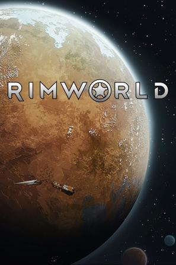
学! 故事模拟器!

4.超越光速 FTL: Faster Than Light [](https://www.douban.com/subject/20471637/)
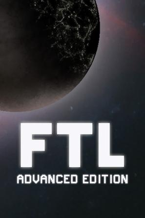
学! 策略设计!

5.勇者斗恶龙：创世小玩家2 破坏神席德与空荡岛 ドラゴンクエストビルダーズ2 破壊神シドーとからっぽの島 [](https://www.douban.com/subject/27110728/)
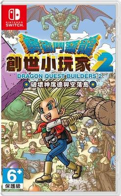
从好玩移动而来, 因为我很少想起他. 生活模拟, 如果是多人, 会更好玩

6.勇者斗恶龙7 重制版 ドラゴンクエストVII Reimagined [](https://www.douban.com/subject/37523509/)
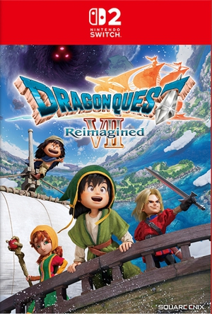
画面很好,ui很好,手感很好, 故事也有点睛之笔, 在许多年前应该是一个好的作品，但是在今天这个讲故事的方式显得拖沓，不和谐!

7.司辰之书 BOOK OF HOURS [](https://store.steampowered.com/app/1028310/BOOK_OF_HOURS/)
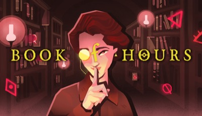
我认为这个作品比《密教模拟器》概念更清晰，而且节奏更自由，没有那么紧张。他也开始展开，和故事，世界融合在一起，很有趣。
作者在访谈中说，它的游戏机制和叙事更和谐地融合在一起，这也是我想做的东西。
但是我不喜欢的一点是，你很难直观地知道什么<东西>能<做>什么，你需要拼命尝试，点击找到可用选项，这让人很沮丧
游戏的驱动力是：好奇心，这个东西还能怎么组合，还有什么新的，这一点和密教模拟器是一样的；游戏的一个hook是图书馆

8.密教模拟器 Cultist Simulator [](https://store.steampowered.com/app/718670/Cultist_Simulator/)
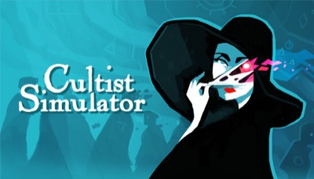
这个游戏看起来像是卡牌游戏，但并不。它们虽然长着卡牌的样子，但是每一个东西都是不一样的。我喜欢这个概念，而且我认为桌游的表现形式是做原型的一种好的方式。
Codex 注：
- 参考：
  [Weather Factory](https://weatherfactory.biz/cultist-simulator/),
  [Alpha and the Why](https://weatherfactory.biz/cultist-simulator-the-alpha-and-the-why/),
  [itch.io 采访](https://itch.io/blog/37131/the-internet-is-not-a-kind-place-for-human-brains-an-interview-with-the-masterminds-behind-cultist-simulator)

9.苏丹的游戏 Sultan's Game [](https://store.steampowered.com/app/3117820)

刚开始觉得很有意思, 故事很吸引人, 也很新颖。不过玩了三四轮之后, 太复杂了, 和密教模拟器一样让人玩起来很累。当一个故事往前推进的时候，你不知道那东西从哪里来，于是漫无目标的等待。你也不知道一个位置能放什么东西，于是一个一个去试。玩起来很疲惫，很烦躁。给我的感觉就好像下面这个用户的评论一样。
```
游戏过程极其枯燥乏味。连续八十回合（！！）点击同一个故事提示简直太疯狂了.
库存管理很快就会变得极其麻烦。排序功能差强人意，而且你会拥有数量惊人的卡牌
总而言之，游戏里充斥着太多杂乱无章的东西。你完成的关卡越多，目标越多，解锁的升级和新路线就越多，但说实话，我感觉这简直是一种惩罚，因为它们只是给游戏增加了更多繁琐的重复劳动。
游戏的画面很棒，设定和故事也很有意思，但我实在提不起劲再打开它，因为感觉就像是在做苦差事。我玩了40个小时，却几乎没看到任何结局奖励，十几个结局里大概只看到了两个？而且还是最简单的结局。一部分原因是翻译很烂，让人搞不清楚该做什么，另一部分原因是做任何事都要花费太多时间。这40个小时玩下来，你只会想"哇，这游戏偷走了我这么多时间"，而不是"哇，这真是个充实的消磨时间的方式"。
```   
通过[Wiki](https://wiki.biligame.com/sultansgame/%E9%80%83%E7%A6%BB%E8%8B%8F%E4%B8%B9%E7%9A%84%E6%B8%B8%E6%88%8F)，我也觉得太复杂，无法理解。他们是很优秀的设计师，但这条路我走不通。我做不了这个，也不会再玩，但也许还有另外一条路......

10.预言奇谈 Foretales [](https://www.douban.com/subject/36094829/)
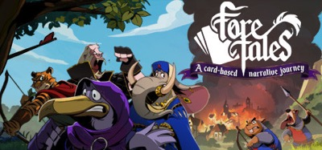
从中学习到场景中的谈话。

11.暗夜刀锋 Blades in the Dark [](https://evilhat.com/product/blades-in-the-dark/)
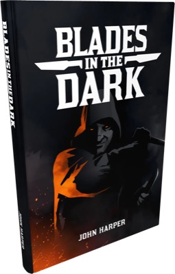

12.国王 Thronefall
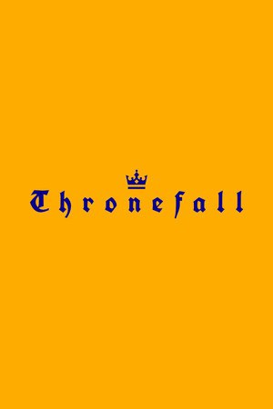
yes, your grace 里面的收获金币-消耗金币-防御 的资源逻辑

13.孤山速降 Lonely Mountains: Downhill [](https://www.douban.com/subject/27052376/)

喜欢他的探索，casual感，一点技巧，不喜欢挑战。我更希望他能变成短途旅行那样的，趣味，探索。
记得去玩孤山独影Cairn， 也让我想起短途旅行a short hike
包括在孤山速降里，我觉得挑战有些太大了，但是它的探索和环境氛围仍然让人享受。孤山独影那个攀登游戏，它是一个技巧游戏，但探索的成分也很多。

14.深空梦里人 Citizen Sleeper [](https://www.douban.com/subject/35507913/)
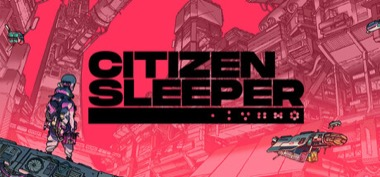

15.文明6 Sid Meier's Civilization VI [](https://store.steampowered.com/app/289070/)

文明系列相当有意思的一点是多种胜利方式。当然战斗还是主线，可是这一点的加入让整个游戏不那么单调了。
它多样的策略是同类型游戏里面的佼佼者，而且更重要的是，它的策略形成了许多故事。（GPT说，它最优秀的地方是“长程决策和复利系统”）
我和朋友在一起玩过很久，一个人的时候我就不会玩它。

16.模拟城市 SimCity (1989) [](https://en.wikipedia.org/wiki/SimCity_(1989_video_game))

我玩的很少，我觉得自己缺乏对于构建一座属于自己的城市的兴趣，想象力和创造力。但是它的设计思想非常有趣，而且它启发了冰汽时代这样的游戏。

17.肖普叔叔的火箭商店 Uncle Chop's Rocket Shop [](https://store.steampowered.com/app/1849790/Uncle_Chops_Rocket_Shop/)

这个游戏启发了我们做一个生活的咖啡机交互游戏。但是后来我不知道该如何继续做下去了，交互是有趣的，但内容呢？
在今天我想起来这个游戏，我觉得设计一个自己的小店，更多的内容也就意味着更多的这种质感、声音，它们用一种经济结构累积起来。当然可能也意味着更复杂的这种生活工具。

18.俄勒冈之旅 The Oregon Trail [](https://store.steampowered.com/app/2013960/The_Oregon_Trail/)

这个游戏的机制也是非常清晰的，我从中学到了很多东西。


19.越过阿尔卑斯山 Over the Alps [ ](https://www.douban.com/subject/34950397/)
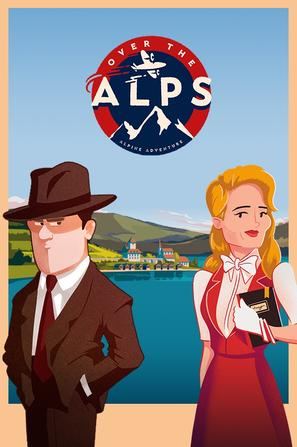
精致的互动绘本, 文本的互动性很强, 给我的代入感最强的文字互动. 虽然玩第二个故事会觉得有点无聊(其实第二个更加抓人, 更戏剧化)

20.肯塔基零号国道 Kentucky Route Zero [](https://www.douban.com/subject/26243467/)

并不是特别喜爱的游戏，但是它和roki，oxenfree一起，让我看到游戏的可能性, 拓宽了游戏设计的边界
有些游戏需要你坐下来，安静下来和他交流。

21.奥森弗里2：信号丢失 OXENFREE II: Lost Signals [](https://www.douban.com/subject/35495044/)
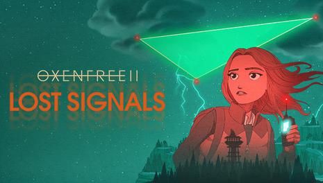
我以为我不喜欢他, 但我常常想起它, 它在构筑游戏世界时候的那些谈话, 那些闲言碎语。

22.节奏光剑 Beat Saber [](https://www.douban.com/subject/30131996/)


23.Just Dance [](https://www.ubisoft.com/en-us/game/just-dance/)


24.舒林 Cozy Grove [](https://www.douban.com/subject/35289538/)
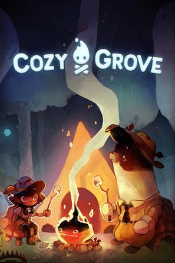
系统简单流畅的生活模拟, 我喜欢他的系统流畅和谐, 不喜欢它的重复.

我现在明白我喜欢它的哪一部分了，点击、拾取、摇晃树木，这些从简单的点击衍生出来的一系列新的玩法，让人感觉优雅和流畅，这种东西是我设计系统的时候追求的美感。

https://www.jank.cool/i-want-to-discover-new-worlds-subnautica-2/ 这篇文章里面列举了许多关于探索和发现的事情。在 Cozy Grove 里面，探索和发现新的东西其实很有趣，不过一旦第二天重复，或者开始经营建设，事情就变得无聊了。应该这么说，这个游戏一开始是探索和发现, 简单的点击在这个世界中也会带来很多的可能性。然而，在完成一次任务之后，这个东西就不再具有探索的乐趣了，它变成了一个手段——为了你的露营，建立一个你自己的家，去养育一些什么一个更高目标的一部分，对我来说，建造养育不是我感兴趣的，所以说，玩了几天之后，我就对他失去了兴趣。

包括在孤山速降里，我觉得挑战有些太大了，但是它的探索和环境氛围仍然让人享受。孤山独影那个攀登游戏，它是一个技巧游戏，但探索的成分也很多。
subnautica以及 outer world 也被视作这种游戏，但是对我来说，不知道是因为3D还是那种自由自在的探索，缺乏目标感，我总是没办法沉浸进去。

25.Cabernet [](https://store.steampowered.com/app/2401410/Cabernet/)
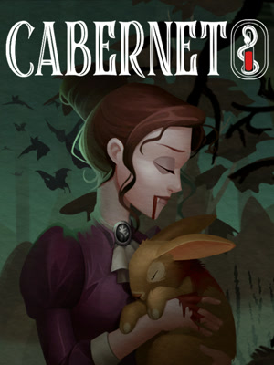
还没玩完，但我觉得它很好。它用二维横向卷轴和自白式叙述讲故事，提供了新奇的吸血鬼视角；吸血鬼能力的玩法和时间分配也让人觉得惊奇。
对玩家而言，只有在选项真正产生意义的时候，选择才真正存在。对于一个战斗游戏，不同选项需要有不同效用。对一个故事而言，只有玩家真正建立起情感的连接，选择才有意义。

26.艾迪芬奇的记忆 What Remains of Edith Finch [](https://store.steampowered.com/app/501300/What_Remains_of_Edith_Finch/)

3D；观看视频，未游玩。
很多人喜欢它是因为它的视觉处理方式像梦一样的感染力，不过对我来说，这个游戏的探索、念白以及引导都非常的有趣。我觉得 In Other Waters 一定从中学习了一些东西，或者说他们之间有一些共性的东西。

27.瘟疫传说：安魂曲 A Plague Tale: Requiem [](https://store.steampowered.com/app/1182900/A_Plague_Tale_Requiem/)

3D；观看视频，未游玩。
它里面经常会，你走到一个地方，那个故事才开始发生，而且不需要日式RPG一样去对话，去搜罗东西。你走过去，然后那些地那些人开始争吵，声音开始发生，然后你可以离开，那些声音还在持续，你走得越远，那些声音就越小，你走到另外一个地方，那个地方事情又发生了。它是用这种沉浸的方式来表现这种空间中的事情，这个手法非常有意思。我基本上不太玩潜行或者什么，我都忘记了，但是这个我一直记得。

[^1]: 如果你想做一个普通人玩的解谜游戏，那你就不应该做一个解谜游戏，应该做一个游戏，它有解谜的要素。如果你擅长的不是玩法、策略，那你就不应该做这些，你要做的是一个游戏有这些要素。Limbo，活侠传，Frostpunk，CitizenSleeper都有这种感觉。
